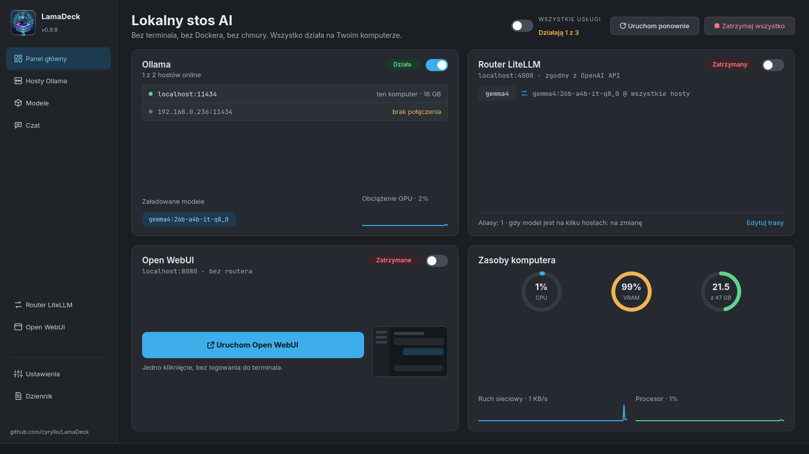

# Ollama Manager

Aplikacja desktopowa (PyQt6) pod KDE, która zaczynała jako prosty manager usługi
[Ollamy](https://ollama.com), a wyrosła w panel sterowania całym lokalnym stackiem AI:
zarządzanie modelami na wielu hostach naraz, agregator modeli (LiteLLM) wystawiający
jeden endpoint zgodny z API OpenAI dla narzędzi typu Continue/VS Code, oraz panel czatu
w przeglądarce (Open WebUI). Bez terminala, bez Dockera, bez chmury — wszystko działa
lokalnie, w Twoim LAN.

> **Status: stabilna (v0.6.0).** Używam jej na co dzień na własnym sprzęcie i działa
> zgodnie z oczekiwaniami. Nadal aktywnie rozwijana — regularnie dochodzą nowe opcje
> i funkcjonalności; [zgłoszenia błędów i uwagi](../../issues) są mile widziane.



## Wymagania

- Python 3 + **PyQt6**, **requests**
- **systemd** + **polkit** (`pkexec`) — standard na KDE/Debian; `install.sh` proponuje instalację
  `pkexec` przez `apt`, jeśli go brakuje (potrzebne do każdej akcji wymagającej uprawnień admina)
- **curl** — używany przez własne przyciski instalacyjne appki (Ollama, oraz uv dla Open WebUI/LiteLLM);
  `install.sh` proponuje jego instalację przez `apt`, jeśli go brakuje
- Ollama (jeśli jej nie masz, aplikacja sama ją zainstaluje jednym przyciskiem)
- Opcjonalnie: **uv** (do instalacji Open WebUI i LiteLLM — aplikacja doinstaluje je sama w razie potrzeby)
- Opcjonalnie: `ffmpeg`, `pandoc`, `zstd` (pełna funkcjonalność Open WebUI — głos, dokumenty w RAG;
  aplikacja proponuje ich instalację przez `apt` zaraz po udanej instalacji Open WebUI)

## Instalacja i uruchomienie

Najpierw sklonuj repozytorium i wejdź do jego katalogu — poniższe skrypty
instalacyjne trzeba uruchamiać stamtąd (szukają `ollama_manager.py` obok siebie):

```
git clone https://github.com/cyryllo/Ollama-manager.git
cd Ollama-manager
```

**Jako aplikacja z menu, bez roota (zalecane)** — instaluje zależności przez pip,
kopiuje apkę do `~/.local/share/ollama-manager` i dodaje wpis w menu (sekcja
Narzędzia). Wykrywa istniejącą instalację i proponuje aktualizację/reinstalację:

```
./install.sh
```

Odinstalowanie: `./install.sh --uninstall` (komunikaty skryptu są po angielsku).

**Jako pakiet `.deb` (Debian/Ubuntu)** — zależności z `apt`, łatwe odinstalowanie:

```
./build-deb.sh
sudo apt install ./ollama-manager_*_all.deb
```

**Ręcznie, do dewelopowania** — bez kopiowania i wpisu w menu:

```
pip install PyQt6 requests
python3 ollama_manager.py
```

## Funkcje

Okno ma pasek boczny z siedmioma ekranami, w ciemnym wyglądzie Breeze (czcionki Inter
i JetBrains Mono są dołączone do programu, więc wygląda tak samo na każdym komputerze).

**Panel główny**
- Jeden przełącznik dla wszystkich usług (Ollama, router LiteLLM, Open WebUI) oraz „Uruchom
  ponownie” i „Zatrzymaj wszystko”
- Karta każdej usługi ze stanem i własnym przełącznikiem — albo przyciskiem „Zainstaluj”, gdy jej
  brakuje (Ollama oficjalnym skryptem, reszta przez `uv`, bez Dockera i bez roota)
- Karta Ollamy: które hosty są online, które modele są w pamięci, obciążenie GPU na żywo
- Karta routera: trasy (alias → model @ hosty) w jednym rzucie oka
- Karta Open WebUI: jeden duży przycisk — zainstaluj / uruchom / otwórz w przeglądarce
- Zasoby komputera: wskaźniki CPU, VRAM i RAM, wykresy sieci i procesora

**Hosty Ollama**
- Wszystkie hosty Ollamy (ten komputer i dowolne w LAN, np. BC-250): online/offline, wersja
  Ollamy, czas odpowiedzi, VRAM i RAM zajęte przez modele (dla tego komputera także całkowita
  pamięć) i modele na każdym hoście — na dysku albo w pamięci
- Dodawanie hosta przez sam adres (`http://` i port 11434 program dopisze sam), usuwanie jednym
  kliknięciem; lista jest wspólna dla routera i ekranu Modele
- Dla tego komputera: ponowne uruchomienie usługi Ollama i przejście do jej dziennika
- Gdy host nie odpowiada, program podpowiada, co sprawdzić (`OLLAMA_HOST=0.0.0.0`)

**Router LiteLLM**
- Jeden adres zgodny z API OpenAI (`http://localhost:4000/v1`) dla wszystkich programów, łączący
  modele ze wszystkich hostów
- Schemat tras na żywo: programy → LiteLLM → aliasy → hosty
- **Aliasy** — stałe nazwy, np. `czat` albo `kod`, dla modelu na wybranych hostach; programy
  używają aliasu, więc model za nim zmienisz bez przestawiania programów
- Co robić, gdy model jest na kilku hostach: na zmianę, najmniej zajęty albo najszybszy
- Wybór, które modele router udostępnia pod własnymi nazwami (pole wyboru przy modelu i hoście)
- Opcjonalny **klucz API** — domyślnie wyłączony (każdy w Twojej sieci może używać modeli)
- Gotowe ustawienia dla **Continue.dev** (`config.yaml` do skopiowania) i instrukcja krok po kroku
  dla **Open WebUI**
- Zmiany czekają na „Uruchom ponownie router” — bez niespodziewanego przestoju

**Modele**
- **Jedna wyszukiwarka dla dwóch źródeł** — oficjalna biblioteka Ollamy i Hugging Face (tylko
  GGUF); wyniki rozwijają się pod polem z każdym wariantem i jego **prawdziwym rozmiarem
  pliku** oraz szacunkiem pamięci. Dokładna nazwa (`llama3.2:3b`, `hf.co/...:Q4_K_M`) + Enter =
  pobieranie od razu; wybierasz host docelowy
- Pole **„Tylko modele MoE”** — pokazuje tylko modele typu mixture of experts (i tylko ich warianty
  MoE), które działają dużo szybciej na APU i komputerach bez mocnej karty graficznej. Rozpoznawane
  po opisie, nazwie, tagach Hugging Face i tagach wariantów Ollamy (np. `30b-a3b`)
- Postęp pobierania z rozmiarem i prędkością oraz przycisk „Anuluj” (wznowi się później tam, gdzie
  przerwało)
- Kafelki modeli ze **wszystkich hostów** z filtrami (czat, kod, embedding, wizja): rozmiar,
  kwantyzacja, długość kontekstu i na których hostach jest model (zielony = w pamięci)
- „Załaduj” / „Zwolnij” model z pamięci, „Kopiuj na host” (pobiera ten sam model na inny host),
  usuwanie z jednego albo ze wszystkich hostów
- Hugging Face to źródło społecznościowe — program podpowiada znanych autorów kwantyzacji

**Czat**
- Prosty wbudowany czat z dowolnym modelem na dowolnym hoście, prosto z Ollamy — działa bez Open
  WebUI i bez routera
- Odpowiedź pojawia się na bieżąco, z formatowaniem (bloki kodu, listy, tabele); można ją przerwać
- **Statystyki szybkości** każdej odpowiedzi, mierzone przez samą Ollamę: generowanie
  i przetwarzanie pytania w tokenach/s, liczba tokenów, czas wczytania modelu, czas całkowity —
  przydatne do porównywania modeli i ustawień Ollamy
- Opcjonalny podgląd rozumowania modelu (modele, które „myślą”, np. qwen3)
- **Załączniki: zdjęcia i pliki tekstowe** — przycisk 📎, przeciągnięcie pliku albo wklejenie
  zrzutu ekranu (Ctrl+V). Zdjęcia trafiają do modeli, które widzą obrazy (vision), pliki
  tekstowe (kod, .txt, .md, .csv…) są dołączane do wiadomości. PDF, Word i arkusze zostają
  dla Open WebUI
- **Duże pliki tekstowe (100 KB – 5 MB) są przeszukiwane, a nie wklejane** — plik jest cięty
  na fragmenty i indeksowany modelem embeddingów w Ollamie (np. `nomic-embed-text`); do każdego
  pytania trafiają najlepiej pasujące fragmenty, a pod odpowiedzią widać, z których linii. Nic
  poza Ollamą nie jest potrzebne, nic nie jest zapisywane na dysku
- Rozmowy nie są zapisywane — pełny czat z historią daje Open WebUI
- Otwiera się też wprost z okienka zasobnika („Otwórz czat”)

**Open WebUI**
- Uruchom, uruchom ponownie, zatrzymaj, otwórz w przeglądarce, kopiuj adres
- Ustawienia: otwieranie przeglądarki po starcie, wymaganie logowania (wyłączyć da się tylko,
  dopóki nie ma kont — inaczej Open WebUI zablokowałby istniejących użytkowników), port
- Szczegóły instalacji: środowisko, gdzie są czaty, czy jest połączony z routerem;
  **kopia zapasowa** wszystkich czatów jednym kliknięciem (plik ZIP)
- Po świeżej instalacji propozycja opcjonalnych pakietów `ffmpeg`/`pandoc`/`zstd` (głos, dokumenty
  w RAG — jedyny krok wymagający uprawnień administratora)

**Dziennik**
- Komunikaty Ollamy, LiteLLM, Open WebUI i samego programu w jednym miejscu, z filtrem usług
- Błędy z **prostym wyjaśnieniem**, co znaczą, i — gdy to ma sens — linkiem „Pokaż host”
- Zapis do pliku, czyszczenie widoku, automatyczne przewijanie
- Dziennik usługi Ollama wymaga uprawnień: wczytasz go raz (hasło) albo zezwolisz na stałe

**Zasobnik systemowy** (opcjonalny, domyślnie wyłączony — włączasz w Ustawieniach)
- Ikona przy zegarze z małym panelem: zainstalowane usługi z przełącznikami, CPU / VRAM / RAM,
  modele w pamięci i przyciski otwierające wbudowany czat albo panel
  zarządzania
- Zamknięcie okna chowa je do zasobnika; program kończysz z menu ikony
- Opcjonalnie start programu po zalogowaniu, od razu schowanego w zasobniku
- Działa tylko jedna kopia programu — ponowne uruchomienie po prostu pokazuje okno

**Ustawienia**
- Język interfejsu — polski, angielski, niemiecki, hiszpański, francuski, portugalski, włoski;
  zmiana od razu, zapamiętana między uruchomieniami
- Autostart wszystkich trzech usług w jednym miejscu: Ollama razem z systemem, router i Open WebUI
  po zalogowaniu
- Wersje i sprawdzanie aktualizacji Ollamy, LiteLLM i Open WebUI na żądanie
- Zmienne środowiskowe Ollamy, każda z krótkim opisem: `OLLAMA_KEEP_ALIVE`,
  `OLLAMA_CONTEXT_LENGTH` (domyślne 4096 to za mało do pracy agentowej), `OLLAMA_MAX_LOADED_MODELS`,
  `OLLAMA_NUM_PARALLEL`, `OLLAMA_FLASH_ATTENTION`, `OLLAMA_KV_CACHE_TYPE`, `OLLAMA_VULKAN`,
  `OLLAMA_IGPU_ENABLE`, `OLLAMA_HOST`, `IPAddressAllow` (ograniczenie dostępu z LAN),
  `GGML_VK_VISIBLE_DEVICES`, `OLLAMA_GPU_OVERHEAD` i dowolne własne zmienne — jedno „Zapisz”
  stosuje wszystko jednym restartem usługi

## Uwagi

- Sterowanie usługą Ollama zawsze dotyczy lokalnej maszyny — nawet jeśli w oknie
  wybrany jest zdalny serwer (np. BC-250), start/stop/autostart działają lokalnie.
