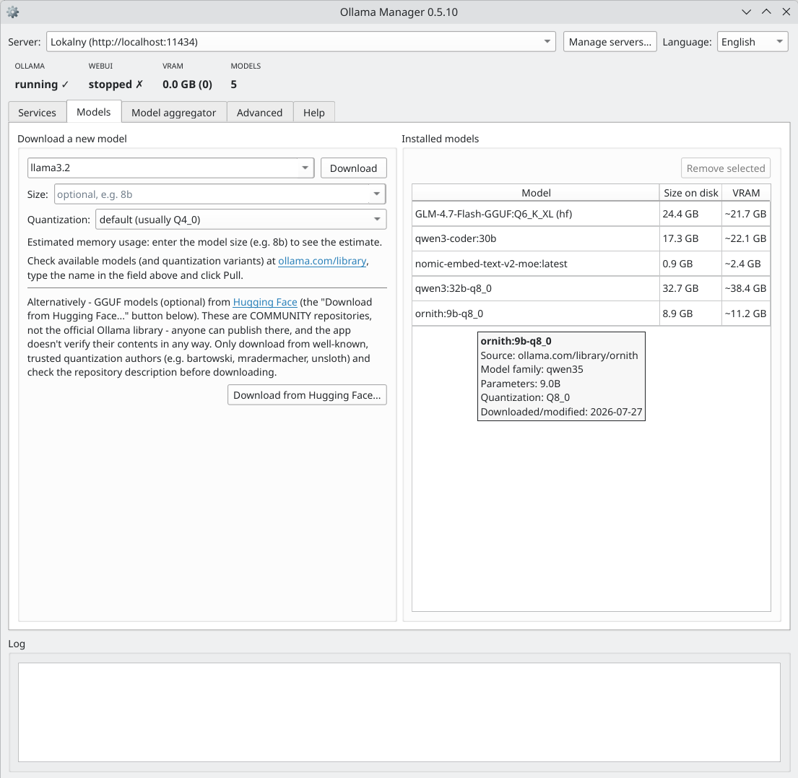

# Ollama Manager

Aplikacja desktopowa (PyQt6) pod KDE, która zaczynała jako prosty manager usługi
[Ollamy](https://ollama.com), a wyrosła w panel sterowania całym lokalnym stackiem AI:
zarządzanie modelami na wielu hostach naraz, agregator modeli (LiteLLM) wystawiający
jeden endpoint zgodny z API OpenAI dla narzędzi typu Continue/VS Code, oraz panel czatu
w przeglądarce (Open WebUI). Bez terminala, bez Dockera, bez chmury — wszystko działa
lokalnie, w Twoim LAN.

> **Status: stabilna (v0.5.0).** Używam jej na co dzień na własnym sprzęcie i działa
> zgodnie z oczekiwaniami. Nadal aktywnie rozwijana — regularnie dochodzą nowe opcje
> i funkcjonalności; [zgłoszenia błędów i uwagi](../../issues) są mile widziane.



## Wymagania

- Python 3 + **PyQt6**, **requests**
- **systemd** + **polkit** (`pkexec`) — standard na KDE/Debian; `install.sh` proponuje instalację
  `pkexec` przez `apt`, jeśli go brakuje (potrzebne do każdej akcji wymagającej uprawnień admina)
- **curl** — używany przez własne przyciski instalacyjne appki (Ollama, oraz uv dla Open WebUI/LiteLLM);
  `install.sh` proponuje jego instalację przez `apt`, jeśli go brakuje
- Ollama (jeśli jej nie masz, aplikacja sama ją zainstaluje jednym przyciskiem)
- Opcjonalnie: **uv** (do instalacji Open WebUI i LiteLLM — aplikacja doinstaluje je sama w razie potrzeby)
- Opcjonalnie: `ffmpeg`, `pandoc`, `zstd` (pełna funkcjonalność Open WebUI — głos, dokumenty w RAG;
  aplikacja proponuje ich instalację przez `apt` zaraz po udanej instalacji Open WebUI)

## Instalacja i uruchomienie

Najpierw sklonuj repozytorium i wejdź do jego katalogu — poniższe skrypty
instalacyjne trzeba uruchamiać stamtąd (szukają `ollama_manager.py` obok siebie):

```
git clone https://github.com/cyryllo/Ollama-manager.git
cd Ollama-manager
```

**Jako aplikacja z menu, bez roota (zalecane)** — instaluje zależności przez pip,
kopiuje apkę do `~/.local/share/ollama-manager` i dodaje wpis w menu (sekcja
Narzędzia). Wykrywa istniejącą instalację i proponuje aktualizację/reinstalację:

```
./install.sh
```

Odinstalowanie: `./install.sh --uninstall` (komunikaty skryptu są po angielsku).

**Jako pakiet `.deb` (Debian/Ubuntu)** — zależności z `apt`, łatwe odinstalowanie:

```
./build-deb.sh
sudo apt install ./ollama-manager_*_all.deb
```

**Ręcznie, do dewelopowania** — bez kopiowania i wpisu w menu:

```
pip install PyQt6 requests
python3 ollama_manager.py
```

## Funkcje

**Usługa Ollama**
- Start / stop usługi systemd, wykrywanie stanu na bieżąco
- Autostart przy starcie systemu
- Wykrywanie braku instalacji + przycisk instalującej ją jednym kliknięciem
- Sprawdzanie aktualizacji na żądanie względem najnowszego wydania na GitHubie, z propozycją
  reinstalacji (oficjalny skrypt instalacyjny aktualizuje istniejącą instalację w miejscu),
  gdy masz starszą wersję — przydatne, bo niektóre modele wymagają nowszej Ollamy, żeby w ogóle się wczytać

**Modele**
- **Jedna wyszukiwarka dla dwóch źródeł** — wpisz nazwę modelu, a appka szuka naraz w oficjalnej
  bibliotece Ollamy (ollama.com) i na Hugging Face (tylko modele GGUF). Każdy wynik ma kolumnę
  **Źródło**, więc zawsze wiadomo, skąd jest model. Wybierz wynik, żeby zobaczyć wszystkie jego
  warianty (tagi/kwantyzacje) z **prawdziwym rozmiarem pliku**, wybierz wariant i kliknij
  Pobierz — z paskiem postępu. Nie trzeba znać dokładnego tagu z góry. Warianty MLX (tylko Apple)
  i modele „cloud” (niepobieralne) są pomijane
- Wklejony link do Hugging Face (albo `użytkownik/repo`) od razu pokazuje warianty tego repo;
  wpisanie dokładnej nazwy (np. `llama3.2:3b` albo `hf.co/...:Q4_K_M`) pozwala pobrać bez szukania
- **Hugging Face to opcjonalne, społecznościowe źródło** — każdy może tam coś opublikować, a appka
  nie weryfikuje zawartości repo, więc dopisek w karcie doradza trzymać się znanych autorów
  kwantyzacji (np. bartowski, mradermacher, unsloth)
- Orientacyjne wyliczenie zużycia pamięci dla wybranego wariantu (prawdziwy rozmiar pliku + KV
  cache + bufory, plus zalecany RAM; szczegóły w dymku)
- Tabela zainstalowanych modeli — nazwa, **źródło** (Ollama / Hugging Face), rozmiar na dysku
  i kolumna z szacowanym/realnym VRAM — + usuwanie. Najechanie na wiersz pokazuje źródło (dla HF
  z autorem kwantyzacji), rodzinę modelu, liczbę parametrów, kwantyzację i datę pobrania
- Podgląd modeli aktualnie załadowanych do pamięci (VRAM)
- Uwaga: ollama.com nie ma publicznego API wyszukiwania, więc appka czyta jej strony wyszukiwania
  i tagów — jeśli wygląd strony się zmieni, wyszukiwanie w Ollamie może wymagać poprawki (Hugging
  Face ma prawdziwe API)

**Open WebUI**
- Instalacja panelu czatu w przeglądarce jednym przyciskiem (bez Dockera)
- Start / stop, autostart po zalogowaniu
- Przycisk "Otwórz WebUI" otwiera panel w przeglądarce (bez automatycznego otwierania)
- Sprawdzanie aktualizacji na żądanie względem najnowszego wydania na PyPI, z propozycją
  aktualizacji przez `uv tool upgrade` (bez uprawnień administratora), gdy masz starszą wersję
- Po udanej instalacji appka proponuje doinstalowanie opcjonalnych pakietów `ffmpeg`/`pandoc`/`zstd`
  potrzebnych do transkrypcji głosu i importu dokumentów do RAG (jedyny krok wymagający roota)

**Przełącznik serwera**
- Wybór hosta Ollama (localhost albo dowolny w LAN, np. BC-250) dla operacji na modelach
- Dodawanie/usuwanie serwerów z poziomu okna, zapamiętywane między uruchomieniami

**Agregator modeli (LiteLLM)**
- Instalacja, start/stop i autostart LiteLLM jednym przyciskiem (bez Dockera)
- Wystawia jeden endpoint (zgodny z API OpenAI) łączący modele ze WSZYSTKICH
  serwerów z listy przełącznika — VS Code/Continue wskazuje tylko na ten adres
- Podgląd, jakie modele i hosty trafią do configu, przed uruchomieniem
- Generuje gotowy do wklejenia `config.yaml` dla Continue.dev na podstawie wystawionych modeli —
  appka nigdy sama nie zapisuje tego pliku, tylko podgląd/kopiowanie
- Dane połączenia dla **Unsloth Studio** — Studio nie ma pliku konfiguracyjnego (połączenia dodaje
  się w jego Settings → Connections), więc appka pokazuje dokładnie, co tam wpisać (typ połączenia,
  Base URL, klucz API) i listę ID modeli do skopiowania
- Sprawdzanie aktualizacji na żądanie względem najnowszego wydania na PyPI, z propozycją
  aktualizacji przez `uv tool upgrade` (bez uprawnień administratora), gdy masz starszą wersję

**Zaawansowane (zmienne środowiskowe Ollamy)**
- `OLLAMA_KEEP_ALIVE`, `OLLAMA_CONTEXT_LENGTH` (domyślne 4096 za mało do pracy agentowej),
  `OLLAMA_MAX_LOADED_MODELS`, `OLLAMA_NUM_PARALLEL`, `OLLAMA_FLASH_ATTENTION`, `OLLAMA_KV_CACHE_TYPE`,
  `OLLAMA_VULKAN` (backend Vulkan zamiast ROCm, przydatne na kartach AMD bez pełnego wsparcia ROCm
  np. BC-250), `OLLAMA_IGPU_ENABLE`, `OLLAMA_HOST` (nasłuch w sieci LAN zamiast tylko lokalnie),
  `GGML_VK_VISIBLE_DEVICES` (indeks urządzenia Vulkan — niezbędne na niektórych APU), `OLLAMA_GPU_OVERHEAD`
  (ile VRAM zarezerwować dla reszty systemu — wybór z gotowych profili pulpit/serwer)
- Jeden przycisk "Zapisz" stosuje wszystkie pola naraz i restartuje usługę tylko raz, plus
  przycisk "Zastosuj zalecane wartości", który wypełnia formularz sensownym profilem startowym
  do przejrzenia przed zapisem
- Wolne pole na dowolną inną zmienną środowiskową, spoza gotowego formularza
- Pełne opisy każdej zmiennej są w osobnej zakładce "Pomoc" — ta zakładka zostaje kompaktowa

**Pasek statystyk**
- Status Ollamy i Open WebUI
- Zużycie VRAM na aktualnie wybranym serwerze
- Liczba zainstalowanych modeli

**Dziennik zdarzeń** — log wszystkich operacji, zawsze widoczny na dole okna.

**Język interfejsu** — polski, angielski, niemiecki, hiszpański, francuski, portugalski i włoski, przełączany z poziomu okna, zapamiętywany między uruchomieniami.

## Uwagi

- Sterowanie usługą Ollama zawsze dotyczy lokalnej maszyny — nawet jeśli w oknie
  wybrany jest zdalny serwer (np. BC-250), start/stop/autostart działają lokalnie.
