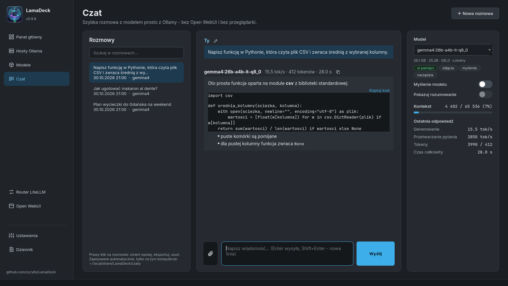
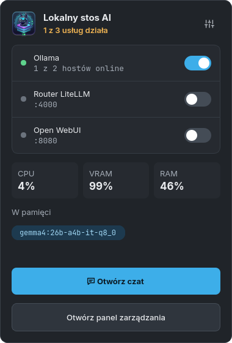

# LamaDeck

Panel sterowania lokalnym stosem AI — aplikacja desktopowa (PyQt6) pod KDE. Zaczynała jako
prosty manager usługi [Ollamy](https://ollama.com), a wyrosła w jedno miejsce dla całego
stosu: zarządzanie modelami na wielu hostach naraz, agregator modeli (LiteLLM) wystawiający
jeden endpoint zgodny z API OpenAI dla narzędzi typu Continue/VS Code, panel czatu
w przeglądarce (Open WebUI) i wbudowany czat, który umie szukać w internecie i podawać źródła.
Bez terminala, bez Dockera, bez chmury —
wszystko działa lokalnie, w Twoim LAN.

> **Do wersji 0.9 LamaDeck nazywał się „Ollama Manager”.** To niezależny projekt, niezwiązany
> z Ollamą. Aktualizacja ze starej nazwy zachowuje ustawienia i rozmowy — program sam je
> przenosi przy pierwszym uruchomieniu.

> **Status: 1.0 — wersja kompletna.** Używam jej na co dzień na własnym sprzęcie. Od teraz
> projekt dostaje już tylko poprawki błędów (patrz [Plan](#plan)). [Zgłoszenia błędów i
> uwagi](../../issues) są mile widziane. Strona projektu: https://cyryllo.github.io/LamaDeck/pl/


## Wymagania

- Python 3 + **PyQt6**, **requests**
- **systemd** + **polkit** (`pkexec`) — standard na KDE/Debian; `install.sh` proponuje instalację
  `pkexec` przez `apt`, jeśli go brakuje (potrzebne do każdej akcji wymagającej uprawnień admina)
- **curl** — używany przez własne przyciski instalacyjne appki (Ollama, oraz uv dla Open WebUI/LiteLLM);
  `install.sh` proponuje jego instalację przez `apt`, jeśli go brakuje
- Ollama (jeśli jej nie masz, aplikacja sama ją zainstaluje jednym przyciskiem)
- Opcjonalnie: **uv** (do instalacji Open WebUI i LiteLLM — aplikacja doinstaluje je sama w razie potrzeby)
- Opcjonalnie: moduł **QtPdf** do załączników PDF w czacie — jest w PyQt6 z pip; w Debianie to
  `python3-pyqt6.qtpdf` (`install.sh` zaproponuje instalację, pakiet `.deb` dociąga go sam)
- Opcjonalnie: `ffmpeg`, `pandoc`, `zstd` (pełna funkcjonalność Open WebUI — głos, dokumenty w RAG;
  aplikacja proponuje ich instalację przez `apt` zaraz po udanej instalacji Open WebUI)

## Instalacja i uruchomienie

**Debian / Ubuntu: z repozytorium APT (zalecane)** — dodajesz je raz, potem LamaDeck
aktualizuje się razem z resztą systemu:

```
sudo curl -fsSLo /usr/share/keyrings/lamadeck-archive-keyring.gpg \
  https://cyryllo.github.io/LamaDeck/apt/lamadeck-archive-keyring.gpg
sudo curl -fsSLo /etc/apt/sources.list.d/lamadeck.sources \
  https://cyryllo.github.io/LamaDeck/apt/lamadeck.sources
sudo apt update
sudo apt install lamadeck
```

Działa też `.deb` ze [strony wydań](../../releases) (`sudo apt install ./lamadeck_*_all.deb`) —
dodaje to samo repozytorium, więc aktualizacje przychodzą tą samą drogą.

**Każda dystrybucja: AppImage** — jeden plik ze wszystkim w środku (Fedora, Arch, openSUSE,
Ubuntu…). Pobierz `LamaDeck-<wersja>-x86_64.AppImage` ze [strony wydań](../../releases), potem:

```
chmod +x LamaDeck-*-x86_64.AppImage
./LamaDeck-*-x86_64.AppImage
```

Przy pierwszym uruchomieniu proponuje dodanie do menu aplikacji (jest też przełącznik
w Ustawieniach); wpis w menu i autostart same się poprawiają po przeniesieniu pliku. Wymaga
glibc 2.34 lub nowszej (Ubuntu 22.04, Debian 12, Fedora 35 i nowsze).

**Z kodu źródłowego** — najpierw sklonuj repozytorium i wejdź do jego katalogu — poniższe skrypty
instalacyjne trzeba uruchamiać stamtąd (szukają `lamadeck.py` obok siebie):

```
git clone https://github.com/cyryllo/LamaDeck.git
cd LamaDeck
```

**Jako aplikacja z menu, bez roota (zalecane)** — instaluje zależności przez pip,
kopiuje apkę do `~/.local/share/lamadeck` i dodaje wpis w menu (sekcja
Narzędzia). Wykrywa istniejącą instalację i proponuje aktualizację/reinstalację:

```
./install.sh
```

Odinstalowanie: `./install.sh --uninstall` (komunikaty skryptu są po angielsku).

**Samodzielne zbudowanie pakietów** — `.deb` (zależności z `apt`) albo AppImage:

```
./build-deb.sh && sudo apt install ./lamadeck_*_all.deb
./build-appimage.sh
```

**Ręcznie, do dewelopowania** — bez kopiowania i wpisu w menu:

```
pip install "PyQt6<6.12" "PyQt6-Qt6<6.12" requests
python3 lamadeck.py
```

## Funkcje

Okno ma pasek boczny z ośmioma ekranami, w ciemnym wyglądzie Breeze (czcionki Inter
i JetBrains Mono są dołączone do programu, więc wygląda tak samo na każdym komputerze).

**Panel główny**
- Jeden przełącznik dla wszystkich usług (Ollama, router LiteLLM, Open WebUI) oraz „Uruchom
  ponownie” i „Zatrzymaj wszystko”
- Karta każdej usługi ze stanem i własnym przełącznikiem — albo przyciskiem „Zainstaluj”, gdy jej
  brakuje (Ollama oficjalnym skryptem, reszta przez `uv`, bez Dockera i bez roota)
- Karta Ollamy: które hosty są online, które modele są w pamięci, obciążenie GPU na żywo
- Karta routera: trasy (alias → model @ hosty) w jednym rzucie oka
- Karta Open WebUI: jeden duży przycisk — zainstaluj / uruchom / otwórz w przeglądarce
- Zasoby komputera: wskaźniki CPU, VRAM i RAM, wykresy sieci i procesora

**Hosty Ollama**
- Wszystkie hosty Ollamy (ten komputer i dowolne w LAN, np. BC-250): online/offline, wersja
  Ollamy, czas odpowiedzi, VRAM i RAM zajęte przez modele (dla tego komputera także całkowita
  pamięć) i modele na każdym hoście — na dysku albo w pamięci
- Na komputerach z **APU** RAM obejmuje też część modelu w pamięci systemowej współdzielonej
  z kartą graficzną (GTT) — widać to jako „Ollama X GB + APU Y GB”
- Dodawanie hosta przez sam adres (`http://` i port 11434 program dopisze sam), usuwanie hosta
  z LAN jednym kliknięciem (ten komputer zostaje zawsze); lista jest wspólna dla routera i ekranu
  Modele
- Dla tego komputera: ponowne uruchomienie usługi Ollama i przejście do jej dziennika
- Gdy host nie odpowiada, program podpowiada, co sprawdzić (`OLLAMA_HOST=0.0.0.0`)

**Router LiteLLM**
- Jeden adres zgodny z API OpenAI (`http://localhost:4000/v1`) dla wszystkich programów, łączący
  modele ze wszystkich hostów
- Schemat tras na żywo: programy → LiteLLM → aliasy → hosty
- **Aliasy** — stałe nazwy, np. `czat` albo `kod`, dla modelu na wybranych hostach; programy
  używają aliasu, więc model za nim zmienisz bez przestawiania programów
- Co robić, gdy model jest na kilku hostach: na zmianę, najmniej zajęty albo najszybszy
- Wybór, które modele router udostępnia pod własnymi nazwami (pole wyboru przy modelu i hoście)
- Opcjonalny **klucz API** — domyślnie wyłączony (każdy w Twojej sieci może używać modeli)
- Gotowe ustawienia dla **Continue.dev** (`config.yaml` do skopiowania) i instrukcja krok po kroku
  dla **Open WebUI**
- Zmiany czekają na „Uruchom ponownie router” — bez niespodziewanego przestoju

**Modele**
- **Jedna wyszukiwarka dla dwóch źródeł** — oficjalna biblioteka Ollamy i Hugging Face (tylko
  GGUF); wyniki rozwijają się pod polem z każdym wariantem i jego **prawdziwym rozmiarem
  pliku** oraz szacunkiem pamięci. Dokładna nazwa (`llama3.2:3b`, `hf.co/...:Q4_K_M`) + Enter =
  pobieranie od razu; wybierasz host docelowy
- Pole **„Tylko modele MoE”** — pokazuje tylko modele typu mixture of experts (i tylko ich warianty
  MoE), które działają dużo szybciej na APU i komputerach bez mocnej karty graficznej. Rozpoznawane
  po opisie, nazwie, tagach Hugging Face i tagach wariantów Ollamy (np. `30b-a3b`)
- Pole **„Modele społeczności”** — pokazuje też modele, które na ollama.com opublikowali inni
  autorzy (`ollama.com/autor/model`, np. `jobautomation/OpenEuroLLM-Polish`); domyślnie wyłączone,
  bo Ollama ich nie sprawdza. Wklejony link do ollama.com otwiera od razu warianty modelu
- Postęp pobierania z rozmiarem i prędkością oraz przycisk „Anuluj” (wznowi się później tam, gdzie
  przerwało); powiadomienie na pulpicie, gdy długie pobieranie (albo instalacja/aktualizacja)
  skończy się w tle
- Kafelki modeli ze **wszystkich hostów** z filtrami (czat, kod, embedding, wizja): rozmiar,
  kwantyzacja, długość kontekstu i na których hostach jest model (zielony = w pamięci)
- „Załaduj” / „Zwolnij” model z pamięci, „Kopiuj na host” (pobiera ten sam model na inny host),
  usuwanie z jednego albo ze wszystkich hostów
- Hugging Face to źródło społecznościowe — program podpowiada znanych autorów kwantyzacji

**Czat**



- Prosty wbudowany czat z dowolnym modelem na dowolnym hoście, prosto z Ollamy — działa bez Open
  WebUI i bez routera
- Odpowiedź pojawia się na bieżąco, z formatowaniem (bloki kodu, listy, tabele) i linkiem
  ikoną **kopiowania** nad każdym blokiem kodu; można ją przerwać
- Małe ikony w nagłówkach wiadomości: **kopiuj** odpowiedź, **wygeneruj ponownie** ostatnią
  odpowiedź (modelem wybranym w tej chwili — wygodne do porównywania modeli) i **popraw**
  ostatnie pytanie
- Gdy model wczytuje się do pamięci (pierwsze pytanie potrafi chwilę potrwać), dymek odpowiedzi
  mówi o tym i odlicza sekundy
- **Statystyki szybkości** każdej odpowiedzi, mierzone przez samą Ollamę: generowanie
  i przetwarzanie pytania w tokenach/s, liczba tokenów, czas wczytania modelu, czas całkowity —
  przydatne do porównywania modeli i ustawień Ollamy
- **Zajętość kontekstu**: ile okna kontekstu modelu zajmuje rozmowa (np. „4 051 / 65 536
  tokenów”), z ostrzeżeniem od 80% — zanim model po cichu zacznie zapominać jej początek
- **Myślenie modelu wł./wył.** dla modeli, które rozważają odpowiedź (qwen3, gemma4…): bez
  myślenia proste pytanie trwa ułamek sekundy zamiast kilkunastu; z myśleniem rozumowanie można
  pokazać w rozmowie
- **Załączniki: zdjęcia, dokumenty i pliki tekstowe** — przycisk 📎, przeciągnięcie pliku albo
  wklejenie zrzutu ekranu (Ctrl+V). Zdjęcia trafiają do modeli, które widzą obrazy (vision),
  pliki tekstowe (kod, .txt, .md, .csv…) są dołączane do wiadomości
- **Dokumenty**: PDF, Word (.docx), Excel (.xlsx), PowerPoint (.pptx), LibreOffice (.odt, .ods,
  .odp) i EPUB — tekst jest z nich wyciągany samym Pythonem i Qt (tabele i arkusze jako wiersze
  `a; b; c`, slajdy i strony PDF z numerami). Zeskanowane PDF-y bez warstwy tekstu i stare
  pliki `.doc`/`.xls`/`.ppt` nie są obsługiwane (czat podpowie, co zrobić)
- **Duże pliki tekstowe (100 KB – 20 MB) są przeszukiwane, a nie wklejane** — plik jest cięty
  na fragmenty i indeksowany modelem embeddingów w Ollamie (np. `nomic-embed-text`); do każdego
  pytania trafiają najlepiej pasujące fragmenty, a pod odpowiedzią widać, z których linii. Nic
  poza Ollamą nie jest potrzebne, nic nie jest zapisywane na dysku. Model embeddingów wybierasz
  w Ustawieniach (karta „Czat”); gdy żadnego nie ma, przycisk pobiera zalecany, wielojęzyczny
  `nomic-embed-text-v2-moe`
- **Wyszukiwanie w internecie ze źródłami**: włączasz je przyciskiem z globusem obok spinacza
  (widać go, gdy w Ustawieniach wybrano źródło wyników). Model pisze 1–3 zapytania, program
  wyszukuje, czyta do 5 stron, wybiera fragmenty pasujące do pytania (modelem embeddingów),
  a odpowiedź podaje je jako [1], [2]… z klikalnymi źródłami pod spodem. Działa z każdym modelem,
  bez wywoływania narzędzi. Wyniki z **SearXNG** — instalowanego jednym kliknięciem na tym
  komputerze, bez konta — z własnego serwera SearXNG albo z wyszukiwarki Ollamy (darmowe konto na
  ollama.com). Domyślnie wyłączone: zapytania wychodzą do internetu tylko, gdy je włączysz
- **Linki w pytaniu**: wklejasz link, a program sam pobiera stronę — wprost z Twojego komputera,
  bez konta — i dołącza jej tekst do pytania (link do PDF też działa; długie strony idą przez
  wyszukiwanie fragmentów). Strony, które wczytują się dopiero w JavaScripcie, program zgłasza
- **Rozmowy zapisują się automatycznie** po każdej odpowiedzi, każda jako plik JSON
  w `~/.local/share/LamaDeck/czaty/` — tylko na Twoim komputerze, bez wpływu aktualizacji
  i dezinstalacji. Lista po lewej pozwala je otwierać, przeszukiwać (tytuły i treść), nazywać
  po swojemu, eksportować do Markdown (`.md`) i usuwać;
  zdjęcia też się zapisują, a duże pliki trzeba dołączyć ponownie, żeby dalej w nich szukać
- Otwiera się też wprost z okienka zasobnika („Otwórz czat”)

**Open WebUI**
- Uruchom, uruchom ponownie, zatrzymaj, otwórz w przeglądarce, kopiuj adres
- Ustawienia: otwieranie przeglądarki po starcie, wymaganie logowania (wyłączyć da się tylko,
  dopóki nie ma kont — inaczej Open WebUI zablokowałby istniejących użytkowników), port
- Szczegóły instalacji: środowisko, gdzie są czaty, czy jest połączony z routerem;
  **kopia zapasowa** wszystkich czatów jednym kliknięciem (plik ZIP)
- Po świeżej instalacji propozycja opcjonalnych pakietów `ffmpeg`/`pandoc`/`zstd` (głos, dokumenty
  w RAG — jedyny krok wymagający uprawnień administratora)

**Dziennik**
- Komunikaty Ollamy, LiteLLM, Open WebUI i samego programu w jednym miejscu, z filtrem usług
- Błędy z **prostym wyjaśnieniem**, co znaczą, i — gdy to ma sens — linkiem „Pokaż host”
- Zapis do pliku, czyszczenie widoku, automatyczne przewijanie
- Dziennik usługi Ollama wymaga uprawnień: wczytasz go raz (hasło) albo zezwolisz na stałe

**Zasobnik systemowy** (opcjonalny, domyślnie wyłączony — włączasz w Ustawieniach)



- Ikona przy zegarze z małym panelem: zainstalowane usługi z przełącznikami, CPU / VRAM / RAM,
  modele w pamięci i przyciski otwierające wbudowany czat albo panel zarządzania (a obok mały
  przycisk „WebUI”, gdy Open WebUI działa)
- Zamknięcie okna chowa je do zasobnika; program kończysz z menu ikony
- Opcjonalnie start programu po zalogowaniu, od razu schowanego w zasobniku
- Działa tylko jedna kopia programu — ponowne uruchomienie po prostu pokazuje okno

**Ustawienia**
- Język interfejsu — polski, angielski, niemiecki, hiszpański, francuski, portugalski, włoski;
  zmiana od razu, zapamiętana między uruchomieniami
- Autostart wszystkich trzech usług w jednym miejscu: Ollama razem z systemem, router i Open WebUI
  po zalogowaniu
- Wersje i sprawdzanie aktualizacji Ollamy, LiteLLM, Open WebUI i SearXNG na żądanie
- Czat: model embeddingów do wyszukiwania w dużych plikach (albo pobranie zalecanego jednym
  przyciskiem) i źródło **wyszukiwania w internecie**: wyłączone, SearXNG na tym komputerze
  (instalacja, start, stop, autostart, aktualizacja, usuwanie — dla użytkownika, bez roota),
  SearXNG pod innym adresem albo wyszukiwarka Ollamy z kluczem API; „Sprawdź wyszukiwanie” wysyła
  jedno próbne zapytanie
- Usługi, których nie ma na komputerze, są tu ukryte — tak samo w pasku bocznym i w zasobniku
- Zmienne środowiskowe Ollamy, każda z krótkim opisem: `OLLAMA_KEEP_ALIVE`,
  `OLLAMA_CONTEXT_LENGTH` (domyślne 4096 to za mało do pracy agentowej), `OLLAMA_MAX_LOADED_MODELS`,
  `OLLAMA_NUM_PARALLEL`, `OLLAMA_FLASH_ATTENTION`, `OLLAMA_KV_CACHE_TYPE`, `OLLAMA_VULKAN`,
  `OLLAMA_IGPU_ENABLE`, `OLLAMA_HOST`, `IPAddressAllow` (ograniczenie dostępu z LAN),
  `GGML_VK_VISIBLE_DEVICES`, `OLLAMA_GPU_OVERHEAD` i dowolne własne zmienne — jedno „Zapisz”
  stosuje wszystko jednym restartem usługi

## Plan

**1.0** to wersja kompletna. Wszystko, co było zaplanowane, jest zrobione:

- [x] Zarządzanie modelami na wielu hostach, router LiteLLM, Open WebUI jednym kliknięciem,
  dziennik z prostymi wyjaśnieniami, okienko w zasobniku, siedem języków
- [x] Wbudowany czat: załączniki i dokumenty, duże pliki przeszukiwane fragmentami, linki
  w pytaniu, zapisywane rozmowy, zajętość kontekstu, myślenie wł./wył., ponowne generowanie
  i poprawianie, kopiowanie i eksport do Markdown
- [x] **Wyszukiwanie w internecie w czacie** ze źródłami (SearXNG albo wyszukiwarka Ollamy)
- [x] Pakiety: własne repozytorium APT, `.deb`, AppImage

**Od teraz: tylko poprawki błędów.** Program robi to, do czego powstał; wszystko większe (konta
użytkowników, bazy wiedzy, agenci, głos) to zadanie Open WebUI — a ono jest wbudowane.

## Uwagi

- Sterowanie usługą Ollama zawsze dotyczy lokalnej maszyny — nawet jeśli w oknie
  wybrany jest zdalny serwer (np. BC-250), start/stop/autostart działają lokalnie.
