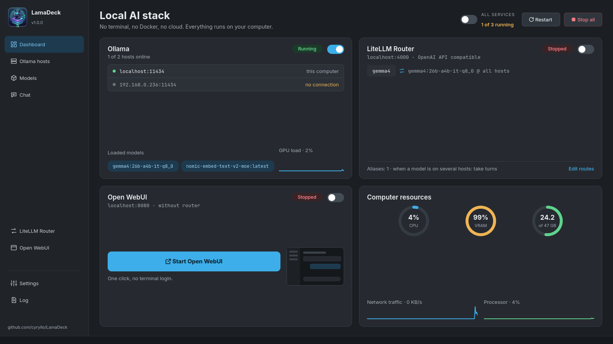
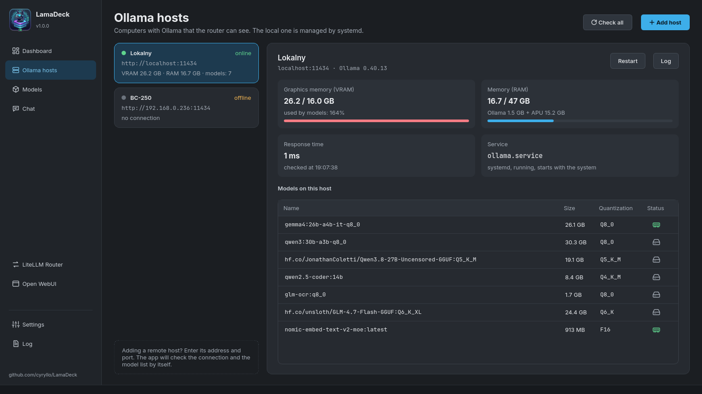
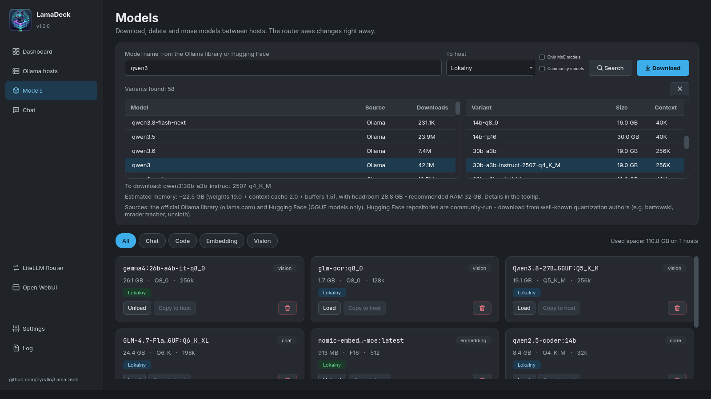
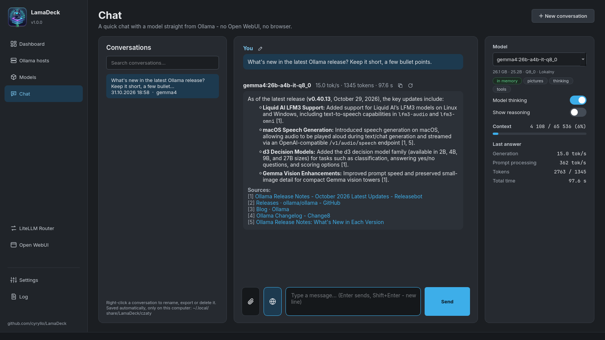
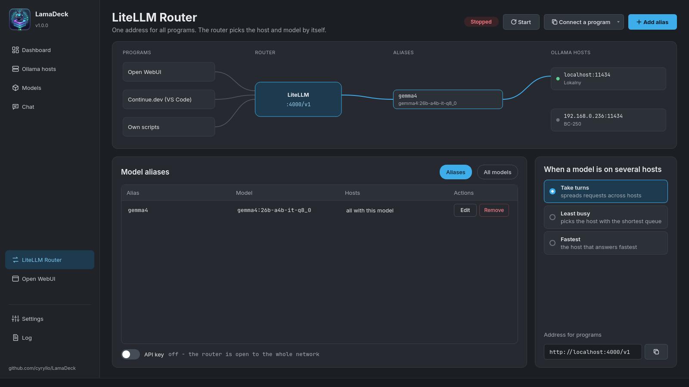
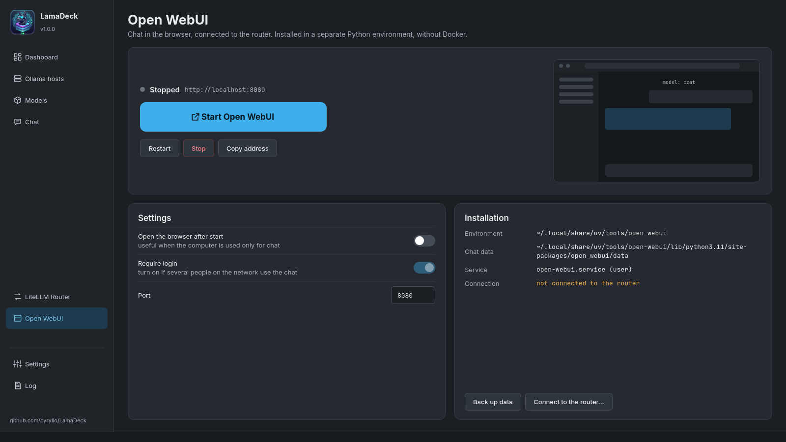
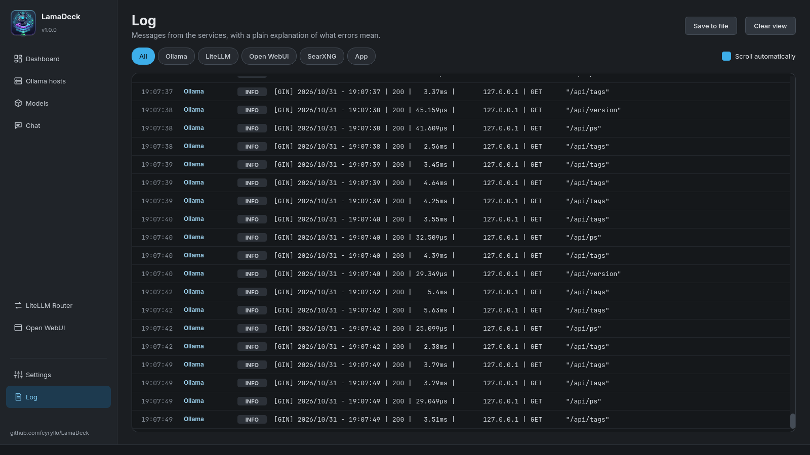
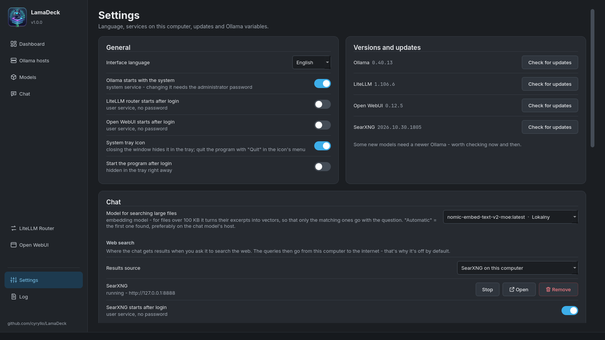
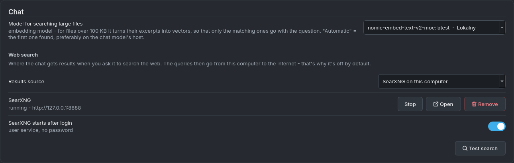
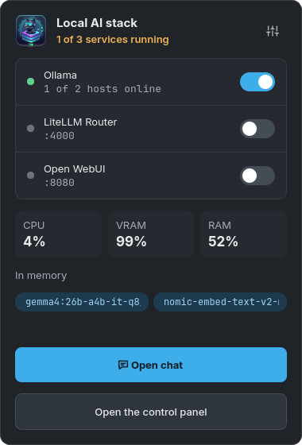

# LamaDeck user guide

What LamaDeck can do, and how to turn each part on. Every screen is described in the order it
appears in the sidebar. *(Po polsku: [PRZEWODNIK.md](PRZEWODNIK.md))*

## Installation and first start

**Debian / Ubuntu** — add the APT repository once, then LamaDeck updates together with the system:

```
sudo curl -fsSLo /usr/share/keyrings/lamadeck-archive-keyring.gpg \
  https://cyryllo.github.io/LamaDeck/apt/lamadeck-archive-keyring.gpg
sudo curl -fsSLo /etc/apt/sources.list.d/lamadeck.sources \
  https://cyryllo.github.io/LamaDeck/apt/lamadeck.sources
sudo apt update
sudo apt install lamadeck
```

The `.deb` file from the [releases page](https://github.com/cyryllo/LamaDeck/releases) works too:
`sudo apt install ./lamadeck_*_all.deb` adds the same repository.

**Any other distribution** — download `LamaDeck-<version>-x86_64.AppImage` from the releases page,
then `chmod +x LamaDeck-*-x86_64.AppImage` and run it. On the first start it asks whether to add
itself to the applications menu.

You'll find LamaDeck in the menu under **Utilities**. Everything else — Ollama, the router, Open
WebUI, SearXNG — is installed from inside the app, with one button each.

> You don't need a terminal for anything below. When an action needs administrator rights
> (installing Ollama, changing its settings), the usual KDE password dialog appears.

## Dashboard



The first screen shows the whole stack on this computer:

- **Ollama** — the switch starts and stops the Ollama service. The card lists the hosts that are
  online, the models loaded in memory and the GPU load.
- **LiteLLM Router** — one address for all your programs (see [LiteLLM Router](#litellm-router)).
- **Open WebUI** — the big button means *Install*, *Start* or *Open in browser*, depending on
  the state.
- **Computer resources** — CPU, VRAM and RAM, network traffic and processor load, updated every
  two seconds.

**Installing the services:** a card of something that isn't installed yet shows an **Install**
button instead of the switch. Ollama is installed with its official script (asks for your
password); the router and Open WebUI install for your user only, without a password and without
Docker. The installation runs in the background, and you get a desktop notification when it
finishes.

At the top, **All services** starts or stops everything in the right order, **Restart** restarts
it, and **Stop all** stops it.

## Ollama hosts



LamaDeck can manage Ollama on several computers at once — this one and others on your home network.

- **Add host** — type the other computer's address (e.g. `192.168.0.236`). `http://` and port
  `11434` are added for you.
- On the **other computer**, Ollama has to accept connections from the network. If it also runs
  LamaDeck: *Settings → Ollama environment variables → `OLLAMA_HOST`* switch on, then **Save**.
- For each host you see the Ollama version, response time, memory used by models and the list of
  models (green memory icon = loaded, grey disk = only on disk).
- **Memory (RAM)** for this computer shows what Ollama really uses. On computers with an **APU**
  (graphics built into the processor) part of a model sits in ordinary RAM shared with the GPU —
  shown as "Ollama X GB + APU Y GB", with details in the tooltip.
- **Restart** and **Log** work for this computer only. This computer can't be removed from the
  list; other hosts have a delete button.

## Models



**Finding and downloading a model:**

1. Type a name (e.g. `qwen3`) and press **Search**. LamaDeck searches the official Ollama library
   and Hugging Face (GGUF files) at the same time.
2. Click a result — on the right you see every variant with its **real file size** and context
   length.
3. Click a variant. Below you see the estimated memory it needs.
4. Choose the target computer in **To host** and press **Download**. The progress bar shows size
   and speed; **Cancel** stops it, and the next download continues where it stopped.

If you know the exact name (`llama3.2:3b`, `hf.co/user/repo:Q4_K_M`), type it and press Enter — the
download starts right away. A pasted link to ollama.com or huggingface.co opens the variants of
that model.

**Filters next to the search field:**

- **Only MoE models** — mixture-of-experts models only. They compute just a part of the model per
  word, so they run much faster on APUs and computers without a strong graphics card.
- **Community models** — also models other people published on ollama.com (`author/model`).
  They're hidden by default, because Ollama doesn't review them.

**Installed models** are shown as tiles from all hosts, filterable by kind (Chat, Code,
Embedding, Vision). Each tile has **Load** / **Unload** (to or from memory), **Copy to host**
(downloads the same model on another computer) and the delete button.

## Chat



A simple chat with any model on any host, straight from Ollama — it works without Open WebUI and
without the router.

**Basics:**

- Choose the model on the right. Tags under it say what it can do: *pictures*, *thinking*,
  *tools*, and whether it's already *in memory*.
- **Enter** sends, **Shift+Enter** starts a new line. While the model writes, **Send** turns into
  **Stop**.
- Under every answer: tokens per second, the number of tokens and the time. The right panel shows
  the details and **Context** — how much of the model's memory for the conversation is used.
  From 80% you get a warning; then start a **New conversation**.
- **Model thinking** turns reasoning on or off for models that think before answering (qwen3,
  gemma4…) — off, short answers come in a fraction of a second. **Show reasoning** shows it in
  the conversation.
- Icons next to an answer: **copy** the answer, **regenerate** it (with the model chosen now —
  handy for comparing models), and **edit** the last question. The icon above a code block copies
  just that code.

**Attachments** — the paperclip button, dragging a file onto the window, or **Ctrl+V** with a
screenshot:

- pictures (for models tagged *pictures*),
- documents: PDF, Word, Excel, PowerPoint, LibreOffice, EPUB,
- text files: code, `.txt`, `.md`, `.csv`…
- Files over 100 KB (up to 20 MB) are searched by excerpts instead of being pasted whole. This
  needs an embedding model — *Settings → Chat → Model for searching large files*; if you have
  none, the **Download** button there gets the recommended one.

**Links:** paste a link into the question and LamaDeck downloads the page itself and adds its text.

**Web search** (the answer cites its sources [1], [2]…):

1. *Settings → Chat → Web search → Results source* — choose **SearXNG on this computer** and press
   **Install** (a few minutes, no password). Or choose your own SearXNG server, or **Ollama**
   with an API key from your free ollama.com account.
2. **Test search** checks that it works.
3. In the chat, click the **globe** button next to the paperclip — it lights up blue. Every
   question is now searched on the internet until you click it again.

The model writes 1–3 search queries, LamaDeck reads up to 5 pages, picks the passages that match
your question, and the answer lists the clickable sources below. In the bubble you can see what
it's doing at the moment.

**Conversations** are saved automatically after every answer (only on this computer). The list on
the left opens them and searches titles and content. Right-click a conversation to **Rename**
(also double-click or F2), **Export to Markdown** or **Delete**.

## LiteLLM Router



The router gives all your programs one address, `http://localhost:4000/v1` (OpenAI-compatible),
behind which are the models of all your hosts.

- **Start** runs it. Changes to routes take effect after **Restart the router** — a bar reminds
  you.
- **Add alias** — a fixed name such as `code` or `chat` for a chosen model. Programs use the
  alias, so you can swap the model behind it without changing anything in them.
- **When a model is on several hosts** — take turns, least busy, or fastest.
- **All models** — which models the router offers under their own names.
- **Connect a program** — ready settings for **Continue.dev** (a `config.yaml` to copy) and
  step-by-step instructions for **Open WebUI**.
- **API key** — off by default (anyone on your network can use the models); on, the key is added
  to the Continue settings.

## Open WebUI



A full chat in the browser (user accounts, knowledge bases, voice) — installed without Docker.

- The big button **installs**, **starts** or **opens** Open WebUI in the browser. **Restart**,
  **Stop** and **Copy address** are below.
- **Settings:** open the browser after start, **Require login** (can be turned off only while
  there are no accounts), and the port.
- **Back up data** saves all chats and accounts to a ZIP file.
- **Connect to the router...** shows how to add the router in Open WebUI, so it sees the models
  of all your hosts.

## Log



Messages from Ollama, LiteLLM, Open WebUI, SearXNG and LamaDeck itself in one place. The buttons at
the top filter by service. Errors come with a **plain explanation** of what they mean and, where
it applies, a link to the host. **Save to file** keeps the log; **Clear view** only hides it.

Reading the Ollama service log needs permission: **Load now** reads it once (asks for your
password), **Allow permanently** adds your account to the `systemd-journal` group (works after you
log in again).

## Settings



- **Interface language** — seven languages, the change is immediate.
- **Autostart** — Ollama with the system, the router and Open WebUI after login.
- **System tray icon** and **Start the program after login** — see [System tray](#system-tray).
- **Versions and updates** — **Check for updates** for Ollama, LiteLLM, Open WebUI and SearXNG.
  Nothing updates by itself.
- **Chat** — the model for searching large files and the web search source (see [Chat](#chat)):



- **Ollama environment variables** (lower on the same screen) — each with a short description.
  **Apply recommended values** fills in a starting set (16k-token context, 30 minutes in memory,
  two models at once, Vulkan for AMD graphics) — it only fills the form, so look it over first.
  **Save** writes everything at once and restarts Ollama once (asks for your password).

## System tray



Turn on *Settings → System tray icon*. Then:

- left click on the icon — this small panel: service switches, CPU / VRAM / RAM, models in memory,
  **Open chat** and **Open the control panel**,
- middle click — the main window, right click — the menu with **Quit**,
- closing the window only hides it in the tray; quit with **Quit** in the icon's menu,
- **Start the program after login** starts LamaDeck already hidden in the tray.

## Where your data is

| What | Where |
|---|---|
| Settings | `~/.config/LamaDeck/LamaDeck.conf` |
| Chat conversations | `~/.local/share/LamaDeck/czaty/` |
| SearXNG | `~/.local/share/LamaDeck/searxng/`, settings in `~/.config/LamaDeck/searxng/` |
| Router settings | `~/.config/LamaDeck/litellm_config.yaml` |
| Open WebUI | `~/.local/share/uv/tools/open-webui/` |

Removing or updating LamaDeck doesn't touch any of these. Nothing leaves your computer, except web
searches you turn on yourself.

## Problems

- **A host is "offline"** — check that the computer is on and that Ollama there accepts network
  connections (`OLLAMA_HOST`, see [Ollama hosts](#ollama-hosts)). The log explains the error.
- **The model forgets the beginning of the conversation** — the context is full (the bar in the
  chat turns red). Start a new conversation or raise `OLLAMA_CONTEXT_LENGTH` in Settings.
- **A big file or web search waits a long time** — the embedding model is loading next to the
  chat model. With `OLLAMA_MAX_LOADED_MODELS=2` (one of the recommended values) both stay in memory.
- **A web search gives no results** — press *Test search* in Settings; SearXNG may be stopped.
  Some search engines occasionally ask for a captcha; SearXNG then uses the others.

Found a bug? [Report it on GitHub](https://github.com/cyryllo/LamaDeck/issues).
