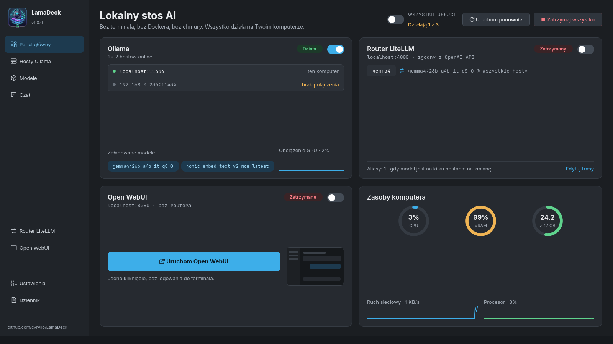
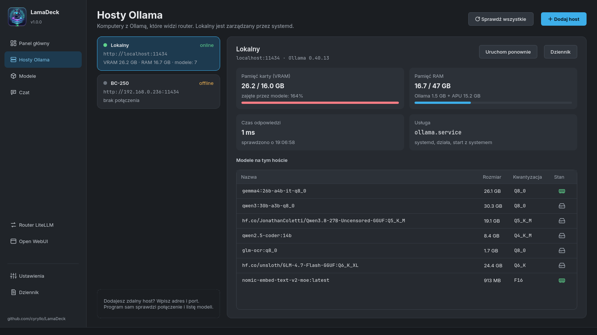
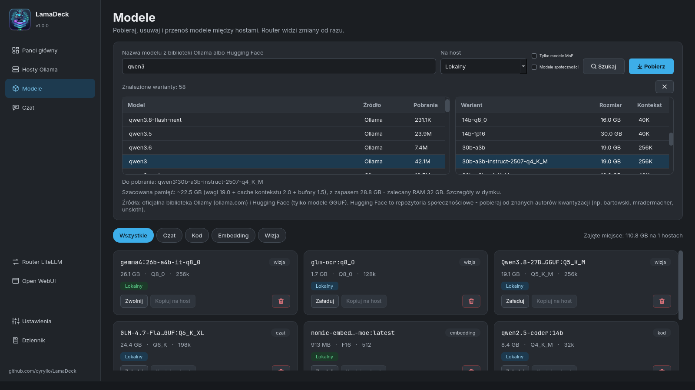
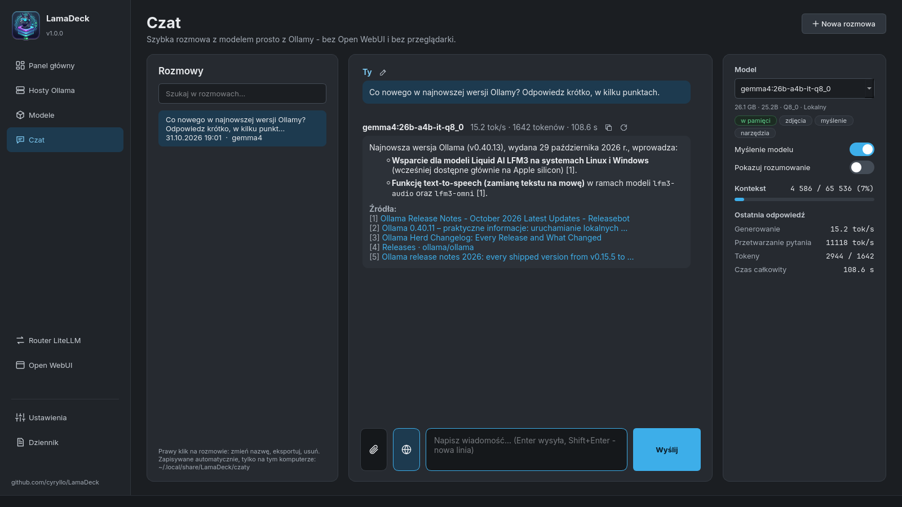
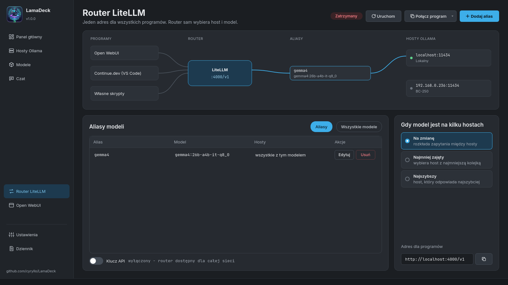
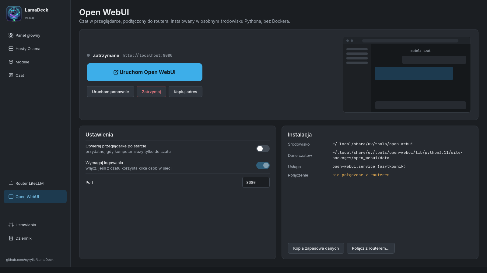
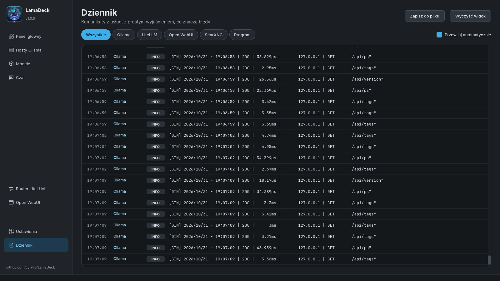
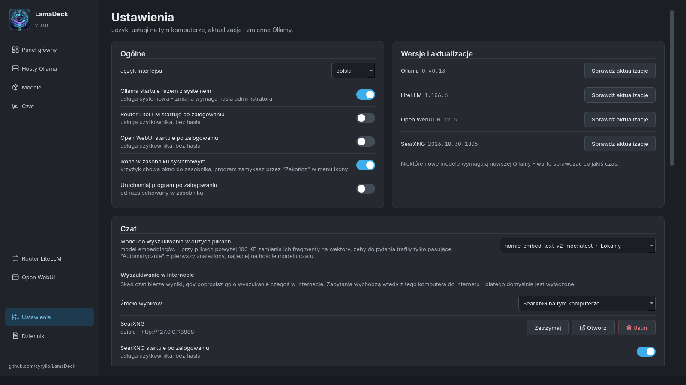
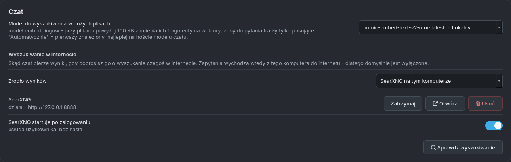
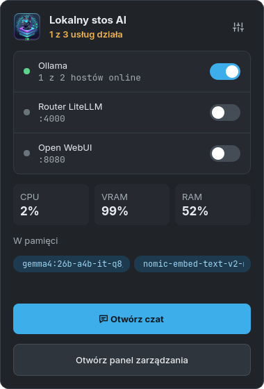

# LamaDeck — instrukcja

Co potrafi LamaDeck i jak włączyć każdą jego część. Ekrany są opisane w kolejności, w jakiej
widać je w pasku bocznym. *(In English: [GUIDE.md](GUIDE.md))*

## Instalacja i pierwsze uruchomienie

**Debian / Ubuntu** — repozytorium APT dodajesz raz, potem LamaDeck aktualizuje się razem
z systemem:

```
sudo curl -fsSLo /usr/share/keyrings/lamadeck-archive-keyring.gpg \
  https://cyryllo.github.io/LamaDeck/apt/lamadeck-archive-keyring.gpg
sudo curl -fsSLo /etc/apt/sources.list.d/lamadeck.sources \
  https://cyryllo.github.io/LamaDeck/apt/lamadeck.sources
sudo apt update
sudo apt install lamadeck
```

Działa też plik `.deb` ze [strony wydań](https://github.com/cyryllo/LamaDeck/releases):
`sudo apt install ./lamadeck_*_all.deb` dodaje to samo repozytorium.

**Każda inna dystrybucja** — pobierz `LamaDeck-<wersja>-x86_64.AppImage` ze strony wydań, potem
`chmod +x LamaDeck-*-x86_64.AppImage` i uruchom. Przy pierwszym starcie zapyta, czy dodać go do menu
aplikacji.

LamaDeck znajdziesz w menu w sekcji **Narzędzia**. Całą resztę — Ollamę, router, Open WebUI,
SearXNG — instalujesz już z poziomu programu, każdą jednym przyciskiem.

> Do niczego, co opisuje ta instrukcja, nie potrzebujesz terminala. Gdy coś wymaga uprawnień
> administratora (instalacja Ollamy, zmiana jej ustawień), pojawia się zwykłe okienko hasła KDE.

## Panel główny



Pierwszy ekran pokazuje cały stos na tym komputerze:

- **Ollama** — przełącznik uruchamia i zatrzymuje usługę Ollama. Karta pokazuje hosty online,
  modele wczytane do pamięci i obciążenie karty graficznej.
- **Router LiteLLM** — jeden adres dla wszystkich programów (patrz [Router LiteLLM](#router-litellm)).
- **Open WebUI** — duży przycisk znaczy *Zainstaluj*, *Uruchom* albo *Otwórz w przeglądarce*,
  zależnie od stanu.
- **Zasoby komputera** — CPU, VRAM i RAM, ruch sieciowy i obciążenie procesora, odświeżane co dwie
  sekundy.

**Instalacja usług:** karta czegoś, czego jeszcze nie ma, pokazuje przycisk **Zainstaluj** zamiast
przełącznika. Ollama instaluje się oficjalnym skryptem (pyta o hasło); router i Open WebUI
instalują się tylko dla Twojego konta, bez hasła i bez Dockera. Instalacja idzie w tle, a gdy się
skończy, dostajesz powiadomienie na pulpicie.

Na górze **Wszystkie usługi** uruchamia albo zatrzymuje wszystko we właściwej kolejności,
**Uruchom ponownie** uruchamia je od nowa, a **Zatrzymaj wszystko** zatrzymuje.

## Hosty Ollama



LamaDeck obsługuje Ollamę na kilku komputerach naraz — na tym i na innych w domowej sieci.

- **Dodaj host** — wpisz adres drugiego komputera (np. `192.168.0.236`). `http://` i port `11434`
  program dopisze sam.
- Na **tamtym komputerze** Ollama musi przyjmować połączenia z sieci. Jeśli też ma LamaDeck:
  *Ustawienia → zmienne środowiskowe Ollamy → przełącznik `OLLAMA_HOST`*, potem **Zapisz**.
- Przy każdym hoście widać wersję Ollamy, czas odpowiedzi, pamięć zajętą przez modele i listę
  modeli (zielona kość pamięci = wczytany, szary dysk = tylko na dysku).
- **Pamięć RAM** tego komputera pokazuje, ile naprawdę zajmuje Ollama. Na komputerach z **APU**
  (grafika wbudowana w procesor) część modelu leży w zwykłym RAM-ie współdzielonym z kartą — widać
  to jako „Ollama X GB + APU Y GB”, szczegóły w dymku.
- **Uruchom ponownie** i **Dziennik** działają tylko dla tego komputera. Tego komputera nie da się
  usunąć z listy; pozostałe hosty mają przycisk usuwania.

## Modele



**Szukanie i pobieranie modelu:**

1. Wpisz nazwę (np. `qwen3`) i naciśnij **Szukaj**. LamaDeck szuka naraz w oficjalnej bibliotece
   Ollamy i na Hugging Face (pliki GGUF).
2. Kliknij wynik — po prawej zobaczysz wszystkie warianty z **prawdziwym rozmiarem pliku**
   i długością kontekstu.
3. Kliknij wariant. Pod spodem widać szacowaną potrzebną pamięć.
4. Wybierz komputer w **Na host** i naciśnij **Pobierz**. Pasek postępu pokazuje rozmiar
   i prędkość; **Anuluj** przerywa, a kolejne pobieranie zacznie od miejsca, w którym przerwało.

Jeśli znasz dokładną nazwę (`llama3.2:3b`, `hf.co/autor/repo:Q4_K_M`), wpisz ją i naciśnij Enter —
pobieranie zacznie się od razu. Wklejony link do ollama.com albo huggingface.co otwiera warianty
tego modelu.

**Pola obok wyszukiwarki:**

- **Tylko modele MoE** — tylko modele typu mixture of experts. Przy każdym słowie liczą tylko część
  modelu, więc działają dużo szybciej na APU i komputerach bez mocnej karty graficznej.
- **Modele społeczności** — także modele, które na ollama.com opublikowali inni ludzie
  (`autor/model`). Domyślnie są ukryte, bo Ollama ich nie sprawdza.

**Zainstalowane modele** to kafelki ze wszystkich hostów, z filtrami (Czat, Kod, Embedding, Wizja).
Każdy kafelek ma **Załaduj** / **Zwolnij** (do pamięci i z niej), **Kopiuj na host** (pobiera ten
sam model na inny komputer) i przycisk usuwania.

## Czat



Prosty czat z dowolnym modelem na dowolnym hoście, prosto z Ollamy — działa bez Open WebUI i bez
routera.

**Podstawy:**

- Model wybierasz po prawej. Tagi pod nim mówią, co potrafi: *zdjęcia*, *myślenie*, *narzędzia*,
  i czy jest już *w pamięci*.
- **Enter** wysyła, **Shift+Enter** to nowa linia. Gdy model pisze, **Wyślij** zmienia się
  w **Zatrzymaj**.
- Pod każdą odpowiedzią: tokeny na sekundę, liczba tokenów i czas. Prawa karta pokazuje szczegóły
  i **Kontekst** — ile pamięci rozmowy modelu jest już zajęte. Od 80% pojawia się ostrzeżenie;
  wtedy zacznij **Nową rozmowę**.
- **Myślenie modelu** włącza albo wyłącza rozumowanie w modelach, które myślą przed odpowiedzią
  (qwen3, gemma4…) — wyłączone daje krótką odpowiedź w ułamku sekundy. **Pokazuj rozumowanie**
  pokazuje je w rozmowie.
- Ikony przy odpowiedzi: **kopiuj** odpowiedź, **wygeneruj ponownie** (modelem wybranym teraz —
  wygodne do porównywania modeli) i **popraw** ostatnie pytanie. Ikona nad blokiem kodu kopiuje sam
  kod.

**Załączniki** — przycisk ze spinaczem, przeciągnięcie pliku na okno albo **Ctrl+V** ze zrzutem
ekranu:

- zdjęcia (dla modeli z tagiem *zdjęcia*),
- dokumenty: PDF, Word, Excel, PowerPoint, LibreOffice, EPUB,
- pliki tekstowe: kod, `.txt`, `.md`, `.csv`…
- Pliki powyżej 100 KB (do 20 MB) są przeszukiwane fragmentami zamiast wklejane w całości. Potrzebny
  jest do tego model embeddingów — *Ustawienia → Czat → Model do wyszukiwania w dużych plikach*;
  jeśli żadnego nie masz, przycisk **Pobierz** w tym miejscu pobierze zalecany.

**Linki:** wklej link do pytania, a LamaDeck sam pobierze stronę i dołączy jej tekst.

**Wyszukiwanie w internecie** (odpowiedź podaje źródła [1], [2]…):

1. *Ustawienia → Czat → Wyszukiwanie w internecie → Źródło wyników* — wybierz **SearXNG na tym
   komputerze** i naciśnij **Zainstaluj** (kilka minut, bez hasła). Albo wybierz własny serwer
   SearXNG, albo **Ollamę** z kluczem API z darmowego konta na ollama.com.
2. **Sprawdź wyszukiwanie** pokaże, czy działa.
3. W czacie kliknij przycisk z **globusem** obok spinacza — podświetli się na niebiesko. Od teraz
   każde pytanie jest szukane w internecie, dopóki nie klikniesz go ponownie.

Model pisze 1–3 zapytania, LamaDeck czyta do 5 stron, wybiera fragmenty pasujące do pytania,
a odpowiedź ma pod spodem listę klikalnych źródeł. W dymku widać, co program właśnie robi.

**Rozmowy** zapisują się same po każdej odpowiedzi (tylko na tym komputerze). Lista po lewej je
otwiera i przeszukuje tytuły oraz treść. Prawy klik na rozmowie: **Zmień nazwę** (też dwuklik
albo F2), **Eksportuj do Markdown** albo **Usuń rozmowę**.

## Router LiteLLM



Router daje wszystkim programom jeden adres, `http://localhost:4000/v1` (zgodny z API OpenAI), za
którym są modele ze wszystkich Twoich hostów.

- **Uruchom** go startuje. Zmiany tras działają po **Uruchom ponownie router** — przypomina o tym
  pasek.
- **Dodaj alias** — stała nazwa, np. `code` albo `chat`, dla wybranego modelu. Programy używają
  aliasu, więc model za nim zmienisz bez zmieniania czegokolwiek w nich.
- **Gdy model jest na kilku hostach** — na zmianę, najmniej zajęty albo najszybszy.
- **Wszystkie modele** — które modele router udostępnia pod własnymi nazwami.
- **Połącz program** — gotowe ustawienia dla **Continue.dev** (`config.yaml` do skopiowania)
  i instrukcja krok po kroku dla **Open WebUI**.
- **Klucz API** — domyślnie wyłączony (modeli może używać każdy w Twojej sieci); włączony trafia
  od razu do ustawień Continue.

## Open WebUI



Pełny czat w przeglądarce (konta użytkowników, bazy wiedzy, głos) — instalowany bez Dockera.

- Duży przycisk **instaluje**, **uruchamia** albo **otwiera** Open WebUI w przeglądarce. Pod nim
  **Uruchom ponownie**, **Zatrzymaj** i **Kopiuj adres**.
- **Ustawienia:** otwieranie przeglądarki po starcie, **Wymagaj logowania** (da się wyłączyć tylko,
  dopóki nie ma żadnych kont) i port.
- **Kopia zapasowa danych** zapisuje wszystkie czaty i konta do pliku ZIP.
- **Połącz z routerem...** pokazuje, jak dodać router w Open WebUI, żeby widział modele ze
  wszystkich Twoich hostów.

## Dziennik



Komunikaty Ollamy, LiteLLM, Open WebUI, SearXNG i samego LamaDeck w jednym miejscu. Przyciski na
górze filtrują po usłudze. Błędy mają **proste wyjaśnienie**, co znaczą, a gdy to pasuje — link do
hosta. **Zapisz do pliku** zachowuje dziennik, **Wyczyść widok** tylko go chowa.

Do dziennika usługi Ollama potrzebne jest pozwolenie: **Wczytaj teraz** czyta go jednorazowo (pyta
o hasło), **Zezwól na stałe** dopisuje Twoje konto do grupy `systemd-journal` (działa po ponownym
zalogowaniu).

## Ustawienia



- **Język interfejsu** — siedem języków, zmiana od razu.
- **Autostart** — Ollama razem z systemem, router i Open WebUI po zalogowaniu.
- **Ikona w zasobniku systemowym** i **Uruchamiaj program po zalogowaniu** — patrz
  [Zasobnik systemowy](#zasobnik-systemowy).
- **Wersje i aktualizacje** — **Sprawdź aktualizacje** dla Ollamy, LiteLLM, Open WebUI i SearXNG.
  Nic nie aktualizuje się samo.
- **Czat** — model do wyszukiwania w dużych plikach i źródło wyszukiwania w internecie (patrz
  [Czat](#czat)):



- **Zmienne środowiskowe Ollamy** (niżej na tym samym ekranie) — każda z krótkim opisem.
  **Zastosuj zalecane wartości** wypełnia formularz punktem startowym (kontekst 16k tokenów,
  30 minut w pamięci, dwa modele naraz, Vulkan dla grafiki AMD) — tylko wypełnia, więc najpierw go
  przejrzyj. **Zapisz** zapisuje wszystko naraz i raz uruchamia Ollamę ponownie (pyta o hasło).

## Zasobnik systemowy



Włącz *Ustawienia → Ikona w zasobniku systemowym*. Wtedy:

- lewy klik na ikonie — to małe okienko: przełączniki usług, CPU / VRAM / RAM, modele w pamięci,
  **Otwórz czat** i **Otwórz panel zarządzania**,
- środkowy klik — główne okno, prawy — menu z **Zakończ**,
- zamknięcie okna tylko chowa je do zasobnika; program kończysz przez **Zakończ** w menu ikony,
- **Uruchamiaj program po zalogowaniu** startuje LamaDeck od razu schowany w zasobniku.

## Gdzie są Twoje dane

| Co | Gdzie |
|---|---|
| Ustawienia | `~/.config/LamaDeck/LamaDeck.conf` |
| Rozmowy z czatu | `~/.local/share/LamaDeck/czaty/` |
| SearXNG | `~/.local/share/LamaDeck/searxng/`, ustawienia w `~/.config/LamaDeck/searxng/` |
| Ustawienia routera | `~/.config/LamaDeck/litellm_config.yaml` |
| Open WebUI | `~/.local/share/uv/tools/open-webui/` |

Usunięcie ani aktualizacja LamaDeck ich nie ruszają. Nic nie wychodzi z Twojego komputera poza
wyszukiwaniem w internecie, które włączasz sam.

## Problemy

- **Host jest „offline”** — sprawdź, czy komputer jest włączony i czy Ollama na nim przyjmuje
  połączenia z sieci (`OLLAMA_HOST`, patrz [Hosty Ollama](#hosty-ollama)). Dziennik wyjaśni błąd.
- **Model zapomina początek rozmowy** — kontekst jest pełny (pasek w czacie robi się czerwony).
  Zacznij nową rozmowę albo zwiększ `OLLAMA_CONTEXT_LENGTH` w Ustawieniach.
- **Duży plik albo wyszukiwanie długo czeka** — obok modelu czatu wczytuje się model embeddingów.
  Przy `OLLAMA_MAX_LOADED_MODELS=2` (jedna z zalecanych wartości) oba zostają w pamięci.
- **Wyszukiwanie nie daje wyników** — naciśnij *Sprawdź wyszukiwanie* w Ustawieniach; SearXNG mógł
  zostać zatrzymany. Niektóre wyszukiwarki czasem pytają o captchę — SearXNG korzysta wtedy
  z pozostałych.

Znalazłeś błąd? [Zgłoś go na GitHubie](https://github.com/cyryllo/LamaDeck/issues).
